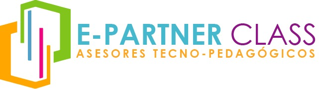

# Aula 4D · Constructor de Prompts Pedagógicos con IA

**E-PARTNER CLASS · Ecosistemas de Aprendizaje con IA**

Recurso educativo interactivo y 100 % autónomo (sin dependencias externas) diseñado bajo principios **ISO 9241** de ergonomía cognitiva y tendencias **UX/UI 2026** para pasar del efecto «wow» al criterio pedagógico al construir herramientas de inteligencia artificial en ecosistemas de aprendizaje.

## 🌐 Acceso web y uso local

- **GitHub Pages (cuando esté activado):** `https://meej76ster-beep.github.io/aula-4d-constructor-prompts/`
- **Uso sin conexión (offline):** descarga o abre directamente [`index.html`](./index.html) o [`aula-4d-constructor-prompts.html`](./aula-4d-constructor-prompts.html) en cualquier navegador moderno.

---

## 🧭 Estructura del recurso

1. **Portada:** Presentación visual con el diagrama orbital centrado en el **Criterio Docente** y accesos directos a la guía y al constructor.
2. **Buenas prácticas 4D:** Resumen instruccional en 3 momentos (*Encuadre previo → Ciclo 4D → Validación humana*) y explorador interactivo de cada dimensión.
3. **Ejemplos comparados:** Tres casos listos (*Simulador de efecto invernadero*, *Estudio de caso y rúbrica de salud comunitaria*, y *Tutor socrático de decisiones éticas con IA*) con contraste *Prompt genérico vs. Prompt 4D*, copia directa y opción para adaptarlos en el constructor.
4. **Constructor (1 paso a la vez):**
   - **Paso 0 · Encuadre instruccional:** Tipo de recurso (*Simulador, Tutor, Actividad situada, Estudio de caso, Guía DUA, Rúbrica o Personalizada*), asignatura/curso, tema central, alcance, objetivos de aprendizaje y **selector flexible de participantes** en 3 modos:
     - *Entorno educativo* (`Preescolar / Inicial`, `Primaria / Básica`, `Secundaria / Media`, `Técnico-Profesional`, `Universitario / Superior`, `Posgrado / Formación Docente` con grados/subniveles dinámicos).
     - *Fuera del entorno escolar* (rangos de edad, edades exactas opcionales y ámbito no formal).
     - *Ambos (Nivel + Edad)*.
   - **Paso 1 · D1 Delegar:** Fase de clase, enfoque pedagógico, nivel UNESCO, tareas delegadas a la IA y decisiones irrenunciables del docente.
   - **Paso 2 · Describir:** Saberes previos, contexto local, modalidad, duración, formato de salida, andamiaje anti «sedentarismo cognitivo» (*Performance ≠ Learning*), criterios observables de logro y usabilidad.
   - **Paso 3 · Discernir:** Rigor disciplinar, prevención de errores conceptuales y alucinaciones, política de fuentes, análisis crítico en aula y auditoría automática.
   - **Paso 4 · Diligencia:** Protección de datos y privacidad, transparencia pedagógica, equidad e inclusión (DUA), evaluación con **supervisión humana obligatoria** y mejora continua.
   - **Paso 5 · Resultado Excelente:** Prompt Maestro en versión **Completo (4D)** o **Compacto**, comparador, copia/descarga (`.md`, `.txt`, impresión/PDF), **Sugerencias de Uso** adaptadas a Claude, ChatGPT, Gemini y Copilot, micro-prompts de iteración, checklist de validación docente y **Diagnóstico 4D**.

---

## 📚 Marcos y referencias integradas

- **Anthropic (2026)** — *AI Fluency Framework (4D: Delegar, Describir, Discernir, Diligencia)*
- **Google for Education (2026)** — *Google AI Educator Series*
- **UNESCO (2024)** — *AI Competency Framework for Teachers*
- **OCDE (2026)** — *Performance ≠ Learning*
- **Comisión Europea & UNICEF (2026)** — *Ética, privacidad y supervisión humana*
- **ISO 9241** — *Ergonomía de la interacción persona-sistema*

---

## 🔖 Control de versiones

- **Versión actual:** `v2.2.0`
- Consulta el historial detallado de mejoras y correcciones en [`CHANGELOG.md`](./CHANGELOG.md).

---

## ✍️ Autoría y licencia

- **Autoría y curaduría pedagógica:** María Esther Espinoza Juárez, Especialista en Tecnopedagogía e Innovación con IA · **E-PARTNER CLASS**
- **Licencia:** CC BY-NC-SA 4.0
